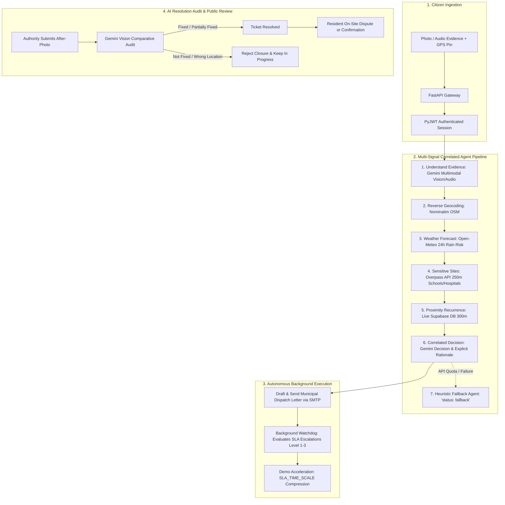

# 🏛️ Jan Aawaz (जनAawaz)
### *Autonomous Civic Grievance Triage & Transparent Municipal Infrastructure Pipeline*

> [!IMPORTANT]
> **Hackathon Prototype Notice**: Jan Aawaz (जनAawaz) is an experimental digital governance and civic pulse prototype submitted for hackathon evaluation. It is **not** an official government portal or statutory public service of the Government of India or any municipal corporation.

[](https://github.com/Syed-Haseeb97/Forge_project/actions/workflows/ci.yml)
[](https://fastapi.tiangolo.com)
[](https://react.dev)
[](https://ai.google.dev)
[](https://supabase.com)
[](https://www.open311.org)

🔗 **Live Production Demo**: [https://janaawaz.vercel.app](https://janaawaz.vercel.app) *(Demo Deployment Placeholder)*  
🎬 **3-Minute Walkthrough Video**: [https://youtu.be/placeholder](https://youtu.be/placeholder) *(Judging Video Placeholder)*

---

## 📌 The Problem

Civic grievances in municipal jurisdictions across India face systemic challenges:
1. **The Bureaucratic Black Hole**: Citizens submit complaints with little visibility into which engineering department received them, who is assigned, or when repairs will occur.
2. **Missing Multi-Signal Urgency Triage**: A pothole next to an active primary school during monsoon season is exponentially more hazardous than a cosmetic crack on a suburban curb, yet existing systems treat them as equal tickets.
3. **Absence of Statutory Accountability**: Citizens have no enforceable Service Level Agreements (SLAs), and dockets linger indefinitely without automated escalation.
4. **Fraudulent Closures**: Dishonest contractors frequently mark dockets "resolved" using false claims or unrelated photos taken miles away.
5. **Language & Linguistic Barriers**: Technical municipal portals are overwhelmingly English-first, excluding non-English speaking citizens from understanding administrative actions.

---

## 💡 The Solution

**Jan Aawaz (जनAawaz)** transforms civic grievance management into an **autonomous, agentic, multi-signal intelligence pipeline**:
- **Multi-Signal Context Correlation**: Correlates visual evidence with live microclimate weather forecasts, OpenStreetMap sensitive site queries (schools, clinics within 250m), and live database recurrence to assign dynamic SLAs (24h to 336h).
- **Autonomous Dispatch Agent**: Automatically drafts formal municipal work orders in English and regional languages with direct Google Maps coordinate links.
- **Statutory SLA Watchdog**: Runs an autonomous background loop escalating overdue tickets from Department Heads to Municipal Commissioners, and ultimately flagging tickets publicly as overdue.
- **Multimodal AI Resolution Auditing**: Uses computer vision to audit "after-photos" against baseline defect photos, strictly rejecting closures if the issue remains unresolved.
- **Multilingual Plain-Language Explainer (जन संवाद)**: Empowers residents across 8 Indian languages with plain-language summaries and browser-based audio narration via the Web Speech API.
- **Strict Zero-Dummy-Data Architecture**: All analytics, map hotspots, and metrics are computed dynamically from real database submissions, official live APIs, and open datasets.

---

## 🌟 Key Features

| Capability | Technical Implementation | Public Benefit |
|---|---|---|
| **Multimodal Ingestion** | Gemini 2.5 Flash Async Client + `python-multipart` | Accepts photos, voice testimonials, and GPS pins without form fatigue. |
| **6-Step Agentic Triage** | Nominatim + Open-Meteo + Overpass API (250m) + Gemini | Context-aware severity scoring that cites weather risks and nearby schools. |
| **Auto-Fill from Photo/Voice** | `POST /api/ai/prefill` structured vision extraction | Pre-populates title, category, description, and detected language. |
| **Autonomous Dispatch** | Background asynchronous worker + SMTP SSL | Issues formal municipal work orders with coordinate links upon submission. |
| **SLA Watchdog Worker** | Asyncio background worker with `SLA_TIME_SCALE` | Tiered escalation (Dept Head ➔ Commissioner ➔ Overdue flag). |
| **Resolution Verification** | Multimodal Gemini Vision comparison (Before vs. After) | Prevents fraudulent ticket closure; rejects unverified work orders. |
| **Resident Dispute Loop** | `POST /api/reports/{id}/feedback` | Residents can confirm completion or dispute to instantly reopen dockets. |
| **8-Language Explainer** | Gemini + `window.speechSynthesis` (Web Speech API) | Accessible audio briefings in Hindi, Tamil, Telugu, Bengali, Marathi, etc. |
| **300m Hotspot Clusters** | Dynamic spatial grid clustering ($\approx 0.0027^\circ$) | Visualizes localized infrastructure failure corridors on Leaflet GIS maps. |
| **Live AI Civic Brief** | Gemini structured summary cached for 10 minutes | Executive summary and 3 prioritized actions synthesized from live DB records. |
| **Open311 v2 Compliance** | `/api/open311/v2/services.json` & `/requests.json` | Interoperable with international civic platforms (FixMyStreet, Mark-a-Spot). |

---

## 🏗️ Agentic Pipeline Architecture



---

## 🌐 Live External Data Sources

Jan Aawaz adheres to a **strict zero-dummy-data policy**. Every statistic, map overlay, and weather correlation originates from live data streams:

| External Provider | Endpoint / Service | Purpose | Timeout & Resilience |
|---|---|---|---|
| **OpenStreetMap Nominatim** | `https://nominatim.openstreetmap.org/reverse` | Reverse geocoding latitude/longitude to street, locality, and city. | $\le 5.8$s timeout, cached by coordinate rounding, rate-limited to 1 req/sec. |
| **Open-Meteo Weather** | `https://api.open-meteo.com/v1/forecast` | Live microclimate precipitation and max 24h rainfall probability. | $\le 5.8$s timeout, public API (no key required), graceful zero-rain fallback. |
| **OpenStreetMap Overpass** | `https://overpass-api.de/api/interpreter` | Overpass QL spatial bounding box query for schools, hospitals, transit hubs within 250m. | $\le 5.8$s timeout, regex-bounded coordinate query, defaults to 0 sites if timed out. |
| **Supabase PostgreSQL** | `aws-0-eu-west-1.pooler.supabase.com:5432` | Live cloud database storing tickets, dispatches, explanations, and audit logs. | Async SQLAlchemy pooler with automated startup migrations (`ensure_schema()`). |
| **Google Gemini API** | `client.aio.models.generate_content` | Multimodal visual inspection, correlated reasoning, and multilingual drafting. | $\le 5.8$s async timeout, multi-model fallback list, deterministic heuristic rules. |
| **Web Speech API** | `window.speechSynthesis` | Client-side text-to-speech audio narration using regional Indian voice engines. | Pure browser native API; UI hides button gracefully if unsupported. |

---

## 📸 Interface & Audit Screenshots

| Screenshot | Description | Path |
|---|---|---|
| **AI Civic Pulse Brief** | Executive municipal brief with 3 prioritized actions and 10-minute live cache badge. | [`docs/screenshots/dashboard_civic_brief.png`](file:///D:/projects/fordge5/fordge/docs/screenshots/README.md) |
| **AI Reasoning Trace** | Full multi-signal audit trace citing Open-Meteo rain, Overpass sensitive sites, and SLA rationale. | [`docs/screenshots/agentic_reasoning_trace.png`](file:///D:/projects/fordge5/fordge/docs/screenshots/README.md) |
| **Plain-Language Explainer** | 8-language citizen ombudsman summary in Hindi with audio listen control. | [`docs/screenshots/multilingual_explainer_hindi.png`](file:///D:/projects/fordge5/fordge/docs/screenshots/README.md) |
| **Official Dispatch Work Order** | Formal bureaucratic work order letter with Google Maps coordinates and SLA deadline. | [`docs/screenshots/dispatch_letter_modal.png`](file:///D:/projects/fordge5/fordge/docs/screenshots/README.md) |
| **Multimodal Resolution Audit** | Comparative AI verification audit rejecting incomplete repairs and logging timeline strikes. | [`docs/screenshots/resolution_audit_before_after.png`](file:///D:/projects/fordge5/fordge/docs/screenshots/README.md) |
| **300m Spatial GIS Hotspots** | Full-screen GIS map view rendering translucent 300-meter circular grievance clusters. | [`docs/screenshots/gis_hotspot_clusters.png`](file:///D:/projects/fordge5/fordge/docs/screenshots/README.md) |

---

## ⚙️ Configuration & Environment Variables

All system configurations are managed via environment variables documented in [`backend/.env.example`](file:///D:/projects/fordge5/fordge/backend/.env.example):

| Variable | Default Value | Description |
|---|---|---|
| `GEMINI_API_KEY` | *None (Required)* | Google Gemini API Key for multimodal triage and structured reasoning. |
| `GEMINI_MODELS` | `gemini-3.5-flash-lite,gemini-3.8-flash,gemini-3.5-flash` | Comma-separated list of Gemini models tried in order. |
| `DATABASE_URL` | `sqlite+aiosqlite:///./fordge.db` | Async SQLAlchemy database URL (SQLite locally, asyncpg for Supabase PostgreSQL). |
| `JWT_SECRET` | *Random Secure String* | Cryptographic secret used to sign 12-hour citizen and authority JWT tokens. |
| `AUTHORITY_EMAILS` | `commissioner@delhi.gov.in,admin@janaawaz.in` | Comma-separated email addresses granted the `authority` role upon authentication. |
| `DEV_MODE` | `false` | When `true`, returns `dev_code` in OTP auth responses for automated testing. |
| `CORS_ORIGINS` | `http://localhost:5173,http://localhost:3000` | Comma-separated allowed CORS origins (no wildcards with credentials). |
| `DISPATCH_EMAIL` | `dispatch@janaawaz.in` | Municipal inbox where automated dispatch letters and work orders are emailed. |
| `WATCHDOG_INTERVAL_SEC` | `60` | Frequency in seconds at which the background SLA watchdog inspects tickets. |
| `SLA_TIME_SCALE` | `1.0` | Demo time compression factor (e.g. `3600` makes 1 hour elapse in 1 real second). |
| `GMAIL_USER` / `GMAIL_APP_PASSWORD` | *Optional* | SMTP credentials for real dispatch and OTP verification emails. |
| `VITE_API_BASE` | `""` (Empty string for relative) | Frontend environment variable specifying backend FastAPI base URL. |

---

## 🚀 Local Development Setup

### Prerequisites
- Python 3.11+
- Node.js 20+ and npm
- Git

### 1. Backend Setup
```bash
cd backend

# Create and activate virtual environment
python -m venv venv
# On Windows:
venv\Scripts\activate
# On Linux/macOS:
source venv/bin/activate

# Install dependencies
pip install -r requirements.txt pytest

# Configure environment
cp .env.example .env
# Edit .env with your GEMINI_API_KEY and DATABASE_URL

# Run database migrations and start server
uvicorn main:app --reload --port 8000
```
Backend API interactive documentation will be available at:  
👉 **http://localhost:8000/docs** (Swagger UI) & **http://localhost:8000/redoc**

### 2. Frontend Setup
```bash
cd frontend

# Install dependencies
npm install

# Start Vite development server
npm run dev
```
Frontend application will be accessible at:  
👉 **http://localhost:5173**

---

## 🧪 Automated Testing & CI/CD

Jan Aawaz includes an automated test suite verifying security auth guards, heuristic fallback degradation, and watchdog worker idempotency.

Run backend tests locally:
```bash
cd backend
python -m pytest tests -v
```

Run frontend production build verification:
```bash
cd frontend
npm run build
```

Both tests run automatically on every pull request and push to `main` via the GitHub Actions workflow in [`.github/workflows/ci.yml`](file:///D:/projects/fordge5/fordge/.github/workflows/ci.yml).

---

## 🚢 Production Deployment Guide

### 1. Database & Object Storage (Supabase)
- Create a Supabase project.
- In **Database Settings > Connection Pooling**, copy the Transaction/Session Pooler connection string.
- Format for async SQLAlchemy: `postgresql+asyncpg://postgres.[REF]:[PASS]@[HOST]:5432/postgres`.
- In **Storage**, create a public bucket named `reports` (or use local filesystem storage via `UPLOAD_DIR`).

### 2. Backend Deployment (Render or Fly.io)
Deploy using the included [`backend/Dockerfile`](file:///D:/projects/fordge5/fordge/backend/Dockerfile):
```dockerfile
FROM python:3.11-slim
WORKDIR /app
COPY requirements.txt .
RUN pip install --no-cache-dir -r requirements.txt
COPY . .
EXPOSE 8000
CMD ["uvicorn", "main:app", "--host", "0.0.0.0", "--port", "8000"]
```
- In your cloud host settings, configure the environment variables listed in the table above.
- Set `DEV_MODE=false`.

### 3. Frontend Deployment (Vercel)
- Link the repository to Vercel with Root Directory set to `frontend`.
- Set Environment Variable: `VITE_API_BASE=https://your-backend-api.onrender.com`.
- The included [`frontend/vercel.json`](file:///D:/projects/fordge5/fordge/frontend/vercel.json) automatically handles single-page routing:
```json
{
  "rewrites": [
    { "source": "/api/(.*)", "destination": "https://your-backend-api.onrender.com/api/$1" },
    { "source": "/(.*)", "destination": "/index.html" }
  ]
}
```

---

## ⚠️ Honest Limitations

As an engineering hackathon prototype, Jan Aawaz acknowledges several practical constraints:
1. **Public Geospatial API Rate Limits**: Reverse geocoding uses the public OpenStreetMap Nominatim API, which strictly enforces a 1 request/second rate limit. In a state-scale deployment, a dedicated self-hosted Nominatim or Mapbox instance would be required.
2. **Overpass API Latency**: The public Overpass API interpreter occasionally experiences traffic surges leading to 2-4 second response times. Jan Aawaz enforces a hard 5.8-second timeout with graceful fallback to zero sensitive sites so user requests never hang.
3. **Simulated Dispatch Inbox**: Because real Indian municipal department engineering heads do not expose programmatic intake mailboxes, dispatches are routed to the centralized `DISPATCH_EMAIL` configured in environment settings.
4. **Browser Speech Synthesis Variations**: The audible plain-language narration utilizes the client device's native `window.speechSynthesis`. Voice naturalness and regional language accent quality depend on the voices installed on the user's operating system and browser.

---

## 📄 License & Attribution

- Built under the **MIT License**.
- Geodata & Mapping © [OpenStreetMap](https://www.openstreetmap.org/copyright) contributors.
- Weather data provided by [Open-Meteo](https://open-meteo.com/) under CC BY 4.0.
- Interoperability protocol aligns with the international [Open311 GeoReport v2](https://www.open311.org) specification.
