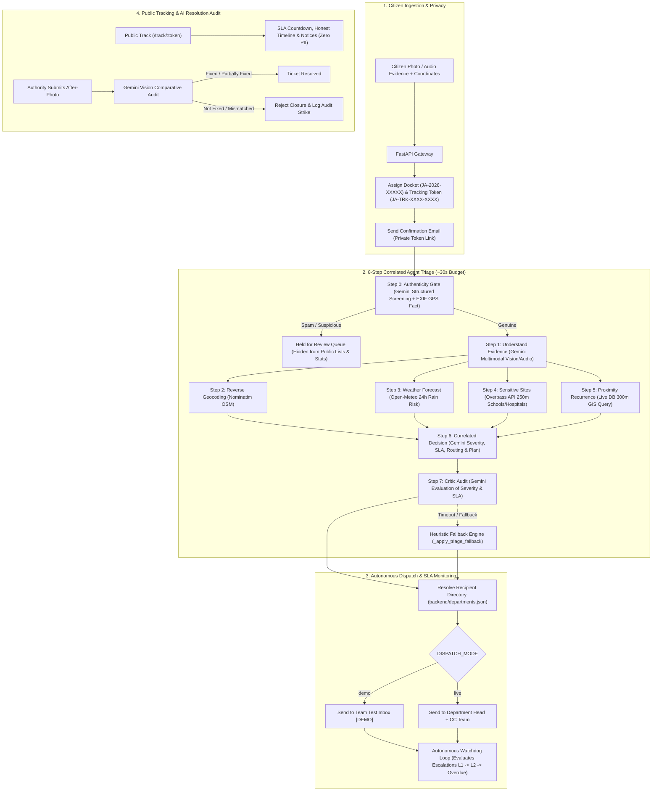

# 🏛️ Jan Aawaz (जनAawaz)
### *Autonomous Civic Grievance Triage & Transparent Municipal Infrastructure Pipeline*

> [!IMPORTANT]
> **Hackathon Prototype Notice**: Jan Aawaz (जनAawaz) is an experimental digital governance and civic pulse prototype submitted for hackathon evaluation. It is **not** an official government portal or statutory public service of the Government of India or any municipal corporation.

[](https://github.com/Syed-Haseeb97/Forge_project/actions/workflows/ci.yml)
[](https://fastapi.tiangolo.com)
[](https://react.dev)
[](https://ai.google.dev)
[](https://supabase.com)
[](https://www.open311.org)

🌐 **Live Production Demo**: `TODO: fill`  
📺 **Walkthrough Video**: `TODO: fill`

---

## 🎯 The Problem

Civic grievances in municipal jurisdictions across India face systemic challenges:
1. **The Bureaucratic Black Hole**: Citizens submit complaints with little visibility into which engineering department received them, who is assigned, or when repairs will occur.
2. **Missing Multi-Signal Urgency Triage**: A pothole next to an active primary school during monsoon season is exponentially more hazardous than a cosmetic crack on a suburban curb, yet traditional systems treat them as equal tickets.
3. **Absence of Enforceable SLAs**: Citizens have no clear Service Level Agreements (SLAs), and complaints linger indefinitely without automated escalation.
4. **Spam & Non-Civic Abuse**: Triage teams spend hours sorting out frivolous submissions, memes, and tests without automated authenticity screening.
5. **Fraudulent Closures**: Dishonest contractors frequently mark dockets "resolved" using false claims or unrelated photos.
6. **Linguistic Barriers**: Municipal systems are English-first, excluding non-English speaking citizens from understanding administrative actions.

---

## 💡 The Solution

**Jan Aawaz (जनAawaz)** transforms civic grievance management into an **autonomous, agentic, multi-signal intelligence pipeline**:
- **8-Step Agentic Triage**: Correlates visual evidence with live microclimate weather forecasts, OpenStreetMap sensitive sites (schools, clinics within 250m), recurrence analysis, and an AI Critic audit before assigning dynamic SLAs (24h to 336h).
- **AI Authenticity Gate**: Screens submissions with prompt isolation (`<report>` boundary) and physical EXIF GPS facts to catch spam while preserving genuine local-language complaints.
- **Privacy-Preserving Public Tracking**: Generates high-entropy tracking tokens (`JA-TRK-XXXX-XXXX`) allowing citizens to monitor live countdowns, timeline audits, and dispatch notices without exposing personal contact info.
- **Autonomous Dispatch Agent**: Resolves real departmental contacts (with demo mode safety to a team inbox) and generates formal municipal work orders with Google Maps coordinates.
- **Automated SLA Watchdog**: Autonomous background worker escalating overdue tickets across tiered notification levels.
- **Multimodal AI Resolution Auditing**: Compares "after-photos" against baseline defect photos with Gemini Vision, strictly rejecting closures if the issue remains unresolved.
- **Multilingual Plain-Language Explainer (जन संवाद)**: Empowers residents across 8 Indian languages with plain-language summaries and browser-based audio narration via the Web Speech API.
- **Strict Zero-Dummy-Data Architecture**: All analytics, map hotspots, and metrics are computed dynamically from real database records, live APIs, and open datasets.

---

## 🤖 Where AI is Used in Jan Aawaz

| Feature | Model / Mechanism | Purpose | Fallback / Guardrail |
|---|---|---|---|
| **Form Pre-fill** | `gemini-3.5-flash-lite` / `gemini-3.8-flash` | Extracts title, category, description, and detected language from image/audio evidence. | Citizen can review, correct, or manually fill all fields. |
| **Authenticity Gate** | `gemini-3.5-flash-lite` (Structured JSON) | Evaluates whether submission is a real civic issue; flags jokes, tests, and non-civic content. | Prompt wrapped in `<report>` (untrusted data rule) + EXIF GPS fact; doubtful cases become "suspicious" for human review. |
| **Evidence Understanding** | `gemini-3.8-flash` Multimodal Vision | Assesses defect type, structural damage, and physical obstruction hazards. | Deterministic category heuristic mapping. |
| **Correlated Decision** | `gemini-3.8-flash` / `gemini-3.5-flash` | Synthesizes weather risk, sensitive site proximity, and recurrence into severity & SLA. | Default SLA matrix based on category and baseline severity. |
| **Critic Audit** | `gemini-3.5-flash-lite` | Adversarially audits the triage decision to prevent over-escalation or under-triage. | Preserves original decision if critic call times out. |
| **Duplicate Detection** | Proximity radius query + text similarity | Detects recurring complaints within 300m to alert citizens and prevent duplicates. | Falls back to coordinate distance filtering if AI unavailable. |
| **Why-Now Prioritization** | `gemini-3.5-flash-lite` (Structured JSON) | Ranks open issues in the Authority Queue by compounding risk factors. | Sorts by SLA deadline and severity level. |
| **Work Order Dispatch** | `gemini-3.5-flash` Structured Drafting | Generates formal, courteous municipal work orders with coordinate links and SLA mandates. | Deterministic work order fallback letter template. |
| **Resolution Vision Audit** | `gemini-3.8-flash` Vision Comparison | Compares "before" and "after" evidence to verify actual repair and reject fraudulent closures. | Flags for manual engineer inspection with closure rejection badge. |
| **Multilingual Explainer** | `gemini-3.8-flash` Translation & Simplification | Converts technical bureaucratic status into plain language across 8 Indian languages. | Deterministic status template + native Web Speech API. |
| **AI Civic Pulse Brief** | `gemini-3.5-flash-lite` Synthesis | Analyzes live municipal database telemetry to generate an executive briefing with 3 actions. | Deterministic stats aggregation with 10-minute caching. |

---

## 🔄 Agentic Pipeline Architecture



---

## 🌐 Live External Data Sources

Jan Aawaz adheres to a **strict zero-dummy-data policy**. Every statistic, map overlay, and weather correlation originates from live data streams:

| External Provider | Endpoint / Service | Purpose | Timeout & Resilience |
|---|---|---|---|
| **OpenStreetMap Nominatim** | `https://nominatim.openstreetmap.org/reverse` | Reverse geocoding latitude/longitude to street, locality, and city. | $\le 5.8$s timeout, cached by coordinate rounding, rate-limited to 1 req/sec. |
| **Open-Meteo Weather** | `https://api.open-meteo.com/v1/forecast` | Live microclimate precipitation and max 24h rainfall probability. | $\le 5.8$s timeout, public API (no key required), graceful zero-rain fallback. |
| **OpenStreetMap Overpass** | `https://overpass-api.de/api/interpreter` | Overpass QL spatial query for schools, hospitals, transit hubs within 250m. | $\le 5.8$s timeout, regex-bounded coordinate query, defaults to 0 sites if timed out. |
| **Supabase PostgreSQL** | `aws-0-eu-west-1.pooler.supabase.com:5432` | Live cloud database storing tickets, dispatches, audit trails, and accounts. | Async SQLAlchemy pooler with automated startup migrations (`ensure_schema()`). |
| **Google Gemini API** | `client.aio.models.generate_content` | Multimodal inspection, authenticity gate, decision reasoning, and vision audit. | 10–12s per call timeout, 3-model fallback list (`GEMINI_MODELS`), deterministic heuristic fallbacks. |
| **Web Speech API** | `window.speechSynthesis` | Client-side text-to-speech audio narration using regional Indian voice engines. | Pure browser native API; UI hides button gracefully if unsupported. |

---

## 📸 Interface & Audit Screenshots

| Screenshot | Description | File Path |
|---|---|---|
| **Documentation & Assets Guide** | Screenshot catalog and documentation overview. | [`docs/screenshots/README.md`](docs/screenshots/README.md) |
| *Product Screenshots* | System screens are captured during live evaluation. | `TODO: fill` |

---

## ⚙️ Configuration & Environment Variables

All system configurations are managed via environment variables documented in [`backend/.env.example`](backend/.env.example):

| Variable | Default Value | Description |
|---|---|---|
| `GEMINI_API_KEY` | *None (Required)* | Google Gemini API Key for multimodal triage, authenticity gating, and reasoning. |
| `GEMINI_MODELS` | `gemini-3.5-flash-lite,gemini-3.8-flash,gemini-3.5-flash` | Comma-separated list of Gemini models tried in priority order. |
| `DATABASE_URL` | `sqlite+aiosqlite:///./fordge.db` | Async SQLAlchemy database URL (SQLite locally, asyncpg for Supabase PostgreSQL). |
| `PUBLIC_APP_URL` | `http://localhost:5173` | Public base URL used to construct citizen tracking and ticket links. |
| `DISPATCH_MODE` | `demo` | `demo` sends work orders to `DISPATCH_EMAIL` labeled `[DEMO]`; `live` sends to resolved municipal recipient. |
| `DISPATCH_EMAIL` | `dispatch@janaawaz.in` | Fallback and demo recipient inbox for automated work orders. |
| `TEAM_CC_EMAILS` | `""` | Comma-separated emails to CC on departmental dispatches. |
| `REPLY_TO` | `""` | Reply-To address ensuring authority responses route back to team coordinators. |
| `EMAIL_PROVIDER` | `smtp` | Transactional email provider: `smtp` (Gmail SSL), `brevo` (REST API), or `resend` (REST API). |
| `GMAIL_USER` / `GMAIL_APP_PASSWORD` | *Optional* | Gmail SMTP credentials when `EMAIL_PROVIDER=smtp`. |
| `BREVO_API_KEY` | *Optional* | Brevo API key when `EMAIL_PROVIDER=brevo`. |
| `RESEND_API_KEY` | *Optional* | Resend API key when `EMAIL_PROVIDER=resend`. |
| `EMAIL_FROM` | *Derived* | Sender name and address for verification codes and dispatch notices. |
| `JWT_SECRET` | *None (Required, >=32 chars)* | Cryptographic secret for signing session tokens. Auto-generated in dev mode. |
| `AUTHORITY_EMAILS` | `""` | Comma-separated emails automatically assigned the `authority` role upon login. |
| `DEV_MODE` | `false` | When `true`, enables local testing OTP return and relaxed JWT rules. |
| `CORS_ORIGINS` | `http://localhost:5173,http://localhost:3000` | Comma-separated allowed CORS origins. |
| `WATCHDOG_INTERVAL_SEC` | `60` | Frequency in seconds for SLA watchdog ticket inspection. |
| `SLA_TIME_SCALE` | `1.0` | Time acceleration factor for hackathon demonstrations (e.g. `3600` = 1 hr in 1 sec). |
| `VITE_API_BASE` | `""` (Empty string for relative) | Frontend environment variable specifying backend FastAPI base URL. |

---

## 🛠️ Local Development Setup

### Prerequisites
- Python 3.11+
- Node.js 20+ and npm
- Git

### 1. Backend Setup
```bash
cd backend

# Create and activate virtual environment
python -m venv venv
# On Windows:
venv\Scripts\activate
# On Linux/macOS:
source venv/bin/activate

# Install dependencies
pip install -r requirements.txt pytest

# Configure environment
cp .env.example .env
# Edit .env with your GEMINI_API_KEY and DATABASE_URL

# Start server
uvicorn main:app --reload --port 8000
```
Interactive API documentation:  
👉 **http://localhost:8000/docs** (Swagger UI) & **http://localhost:8000/redoc**

### 2. Frontend Setup
```bash
cd frontend

# Install dependencies
npm install

# Start Vite development server
npm run dev
```
Frontend application will be accessible at:  
👉 **http://localhost:5173**

---

## 🧪 Automated Testing & CI/CD

Jan Aawaz includes an automated test suite verifying security auth guards, authenticity screening, PII isolation, and watchdog worker idempotency.

Run backend tests locally:
```bash
cd backend
python -m pytest tests -v
```

Verify undefined names (pyflakes & ruff):
```bash
python -m ruff check --select F821 .
```

Run frontend production build verification:
```bash
cd frontend
npm run build
```

All tests run automatically on every pull request and push to `main` via the GitHub Actions workflow in [`.github/workflows/ci.yml`](.github/workflows/ci.yml).

---

## 🚀 Production Deployment Guide

### 1. Database (Supabase PostgreSQL)
- Create a Supabase project.
- In **Database Settings > Connection Pooling**, copy the Transaction/Session Pooler connection string.
- Format for async SQLAlchemy: `postgresql+asyncpg://postgres.[REF]:[PASS]@[HOST]:5432/postgres`.
- Tables and migrations are automatically created on startup via `ensure_schema()`.

### 2. Backend Deployment (Render)
- On Render, connect the repository with root directory `./`.
- Build Command: `pip install -r backend/requirements.txt`
- Start Command: `cd backend && uvicorn main:app --host 0.0.0.0 --port $PORT`
- Configure environment variables from `backend/.env.example`.

### 3. Frontend Deployment (Vercel)
- In Vercel Project Settings, set **Root Directory** to `frontend`.
- Build Command: `npm run build`
- Output Directory: `dist`
- Set Environment Variable: `VITE_API_BASE=https://your-backend.onrender.com`.

---

## 👥 Team & Contributions

| Contributor | Focus Area | Key Contributions |
|---|---|---|
| **Syed Haseeb** (`@Syed-Haseeb97`) | Full-Stack & AI Pipeline Lead | End-to-end 8-step agentic triage, Gemini multimodal reasoning, authenticity gate, privacy tracking, and React/Tailwind frontend. |
| **Teammate 1** | Geospatial & Infrastructure Services | `TODO: fill` |
| **Teammate 2** | UI/UX & Citizen Accessibility | `TODO: fill` |

---

## 🔍 Honest Limitations

As an engineering hackathon prototype, Jan Aawaz acknowledges several practical constraints:
1. **Demo Mode Dispatch by Default**: Automated dispatch letters run in `DISPATCH_MODE=demo` by default, routing work orders to the configured `DISPATCH_EMAIL` with a `[DEMO]` tag. In `live` mode, letters are routed directly to resolved municipal recipients.
2. **Municipal Recipient Directory**: Currently includes one fully verified official municipal directory entry (Tiruchirappalli City Municipal Corporation street lights via `commr.trichy@tn.gov.in`, verified on TN Urban Tree). All unmapped municipal jurisdictions cleanly fall back to `DISPATCH_EMAIL` with an honest timeline notice.
3. **Documented Policy Configuration**: Category definitions, standard SLA targets (`DEFAULT_SLA_MAP`), and department routing mappings in `backend/config.py` reflect administrative civic policy configuration, not mock data.
4. **Public Geospatial API Rate Limits**: Reverse geocoding uses the public OpenStreetMap Nominatim API (1 req/s rate limit). Overpass sensitive site queries enforce a 5.8s timeout with graceful fallback.
5. **Browser Speech Synthesis Variations**: Multilingual audio narration uses client-side `window.speechSynthesis`. Voice quality and language accent availability depend on the user's OS and browser voice libraries.

---

## 📄 License & Attribution

- Released under the open-source [MIT License](LICENSE).
- Geodata & Mapping © [OpenStreetMap](https://www.openstreetmap.org/copyright) contributors.
- Weather data provided by [Open-Meteo](https://open-meteo.com/) under CC BY 4.0.
- Interoperability protocol aligns with the international [Open311 GeoReport v2](https://www.open311.org) specification.
