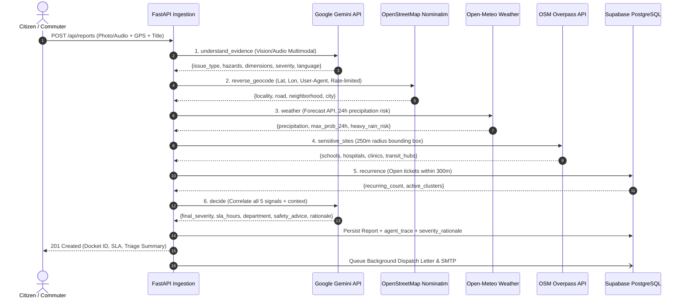
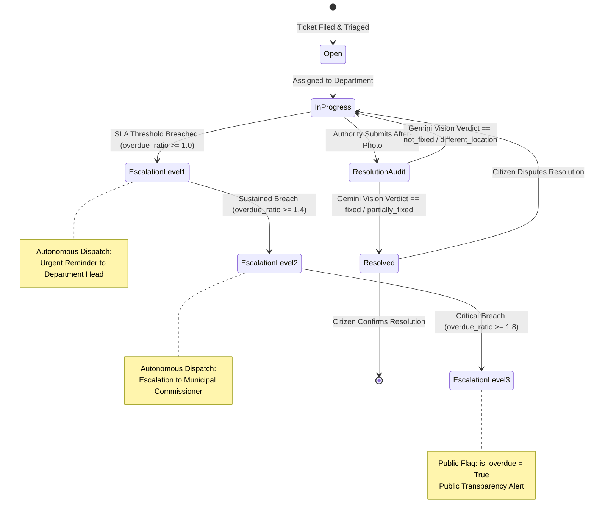
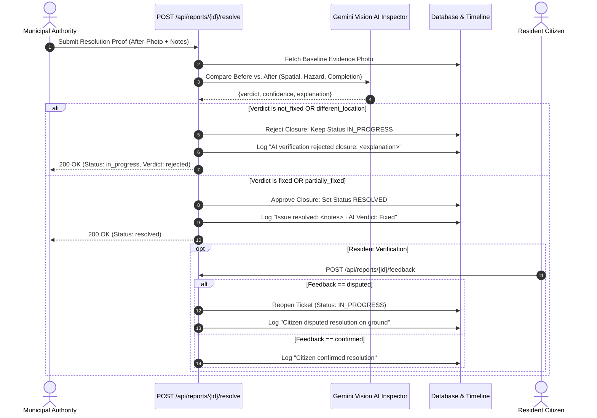
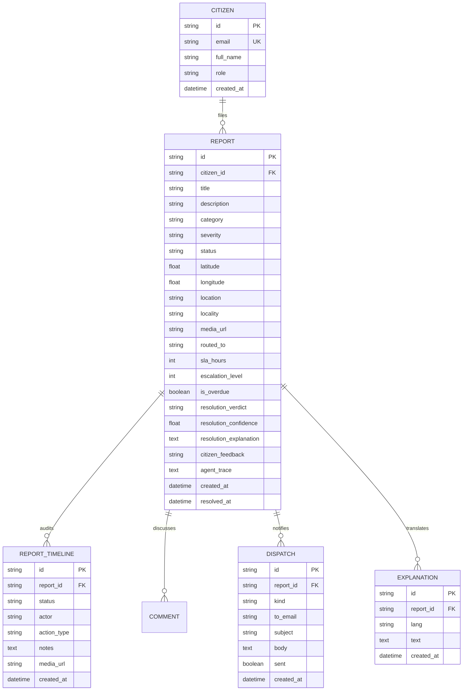

# 🏛️ Jan Aawaz (जनAawaz) – Technical Architecture & Agent Specification

Jan Aawaz is an autonomous civic grievance triage, dispatch, and public infrastructure monitoring system engineered for municipal governance, statutory accountability, and transparent citizen redressal.

---

## 1. System Architecture Overview

The system is organized into four core architectural planes:
1. **Civic Ingestion Plane**: Multimodal evidence capture (photos, voice notes, GPS coordinates, descriptions) with JWT-authenticated citizen credentials.
2. **Autonomous Multi-Signal Agent Triage Plane**: 6-step agentic pipeline integrating Gemini Multimodal reasoning, Nominatim geocoding, Open-Meteo microclimate weather, Overpass sensitive sites (250m), and live DB recurrence correlation.
3. **Municipal Dispatch & SLA Watchdog Plane**: Automated formal complaint work-order drafting via Gemini (English + regional language) and an asynchronous background watchdog worker managing tiered statutory escalations.
4. **Resolution Audit & Accountability Plane**: Computer-vision-based before/after verification rejecting false closures, citizen dispute reopening, and spatial 300m hotspot clustering.

```mermaid
flowchart TD
    subgraph Client["Frontend Layer (React 18 + Vite + Tailwind)"]
        A1[Citizen Reporting & Media Capture]
        A2[Interactive GIS Map & 300m Hotspots]
        A3[Public Docket & Multilingual Explainer]
        A4[Municipal Authority Dashboard]
    end

    subgraph API["FastAPI Gateway & Security"]
        B1[PyJWT Auth & RBAC Guard]
        B2[Open311 GeoReport v2 Endpoints]
        B3[Background Task Dispatcher]
        B4[Database Migrations Engine]
    end

    subgraph AgenticPipeline["Agentic Triage Pipeline"]
        C1[Step 1: Understand Evidence (Gemini Vision/Audio)]
        C2[Step 2: Reverse Geocode (Nominatim)]
        C3[Step 3: Microclimate Weather (Open-Meteo)]
        C4[Step 4: Sensitive Sites 250m (Overpass API)]
        C5[Step 5: Proximity Recurrence (Live DB)]
        C6[Step 6: Correlated Decision (Gemini Structured)]
        C7[Step 7: Heuristic Fallback Agent]
    end

    subgraph BackgroundWorkers["Autonomous Background Agents"]
        D1[Dispatch Agent: Formal Letter Generator]
        D2[SLA Watchdog Worker: Tiered Escalations]
        D3[Resolution Verification: Multimodal Image Audit]
        D4[Civic Intelligence: Spatial 300m Hotspot Clusters]
    end

    subgraph Storage["Persistence & External Services"]
        E1[(Supabase PostgreSQL / SQLite)]
        E2[Supabase Storage S3 / Local Media]
        E3[SMTP Email Gateway]
        E4[Web Speech API]
    end

    A1 -->|Multipart /api/reports| B1
    B1 --> C1
    C1 --> C2 --> C3 --> C4 --> C5 --> C6
    C6 -.->|Failure Fallback| C7
    C6 -->|Persist Ticket & Trace| E1
    B3 --> D1
    D1 -->|Work Order Letter| E3
    D2 -->|Periodic SLA Check| E1
    D2 -->|Escalation Notice| D1
    A4 -->|Resolve Proof| D3
    D3 -->|Approve/Reject| E1
    A3 -->|Explain Request| E4
    A2 -->|Fetch Hotspots| D4
    D4 -->|Grid Clustering| E1
```

---

## 2. Multi-Signal Agent Triage Pipeline

Every civic grievance submitted undergoes a deterministic, multi-signal correlated audit before departmental work-orders are assigned.



---

## 3. SLA Watchdog & Autonomous Escalation Cycle

Municipal accountability is enforced by an autonomous background worker running every `WATCHDOG_INTERVAL_SEC` (default: 60s) with support for demo time compression (`SLA_TIME_SCALE`).



---

## 4. Multimodal Resolution Audit Loop

To prevent fraudulent municipal closures where contractors mark tickets resolved without performing on-site repairs, the resolution endpoint executes an autonomous computer-vision comparison.



---

## 5. Spatial Hotspot Clustering Math (~300m)

Hotspot clusters are computed purely from live database records without precomputed dummy coordinates:
- 1° Latitude $\approx 111,139\text{ m} \implies 300\text{ m} \approx 0.0027^\circ$.
- 1° Longitude at latitude $28^\circ\text{ N} \approx 98,000\text{ m} \implies 300\text{ m} \approx 0.0030^\circ$.
- Reports are mapped into spatial grid cells:
  $$\text{Cell} = \left(\left\lfloor \frac{\text{lat}}{0.0027} + 0.5 \right\rfloor, \left\lfloor \frac{\text{lon}}{0.0030} + 0.5 \right\rfloor\right)$$
- Centroids are calculated as the arithmetic mean of all reports in the grid cell.
- Clusters with $\ge 2$ grievances are designated as active municipal hotspots.

---

## 6. Database Entity Relationship Model


